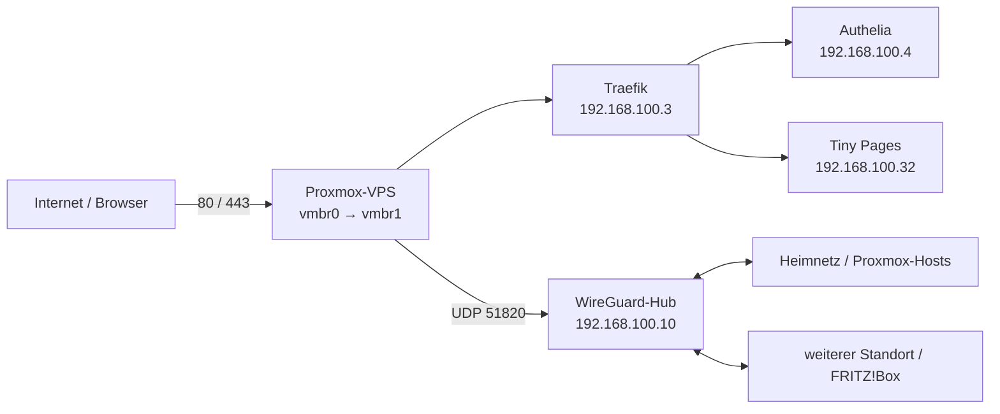

# Proxmox-Musterlösung: VPS, Traefik und Authelia

Dieses Repository erklärt eine tatsächliche Proxmox-VPS-Anlage als Beispiel. Es enthält einen dokumentierten Netzplan, reale interne IPs und Container-IDs, ausgewählte Portweiterleitungen und eine KI-Kopiervorlage. Prüfe vor Änderungen, welche Werte und Providerbedingungen auf dein eigenes System passen.

## Die Idee

Ein Proxmox-VPS betreibt getrennte LXC-Container. Traefik nimmt Webanfragen entgegen; Authelia kann Zugriffe absichern. Ein kleiner Webserver stellt Testseiten bereit. Je nach Provider braucht der Host eine interne Bridge, Routing, ausgehendes NAT und DNAT für die Webports. Welche Regeln tatsächlich nötig sind, hängt von deinem VPS und seinem bestehenden Netzwerk ab.

Beispiel aus einer bestehenden Anlage, als Orientierung – **nicht ungeprüft übernehmen**:

| Komponente | Beispiel |
| --- | --- |
| Privates Netz / Gateway | `192.168.100.0/24` / `192.168.100.1` |
| Interne Bridge | `vmbr1` |
| Traefik | LXC `1003`, `192.168.100.3` |
| Authelia | LXC `1004`, `192.168.100.4` |
| Tiny Pages | LXC `100032`, `192.168.100.32` |

Die Werte wurden am 10. November 2026 an der Beispielanlage lesend abgefragt; dein eigener Server kann abweichen. Eine öffentliche WAN-IP oder Zugangsdaten sind hier bewusst nicht enthalten. Die zugehörige Benutzerverwaltung und ihr Entwicklungsstand stehen im Repository [Authelia Onboarding](https://github.com/WaldemarFech/authelia-onboarding).

## Aufbau auf einen Blick



[**Architektur mit allen Beispieldiensten →**](docs/01-architektur.md) · [**Netzwerk und DNAT →**](docs/02-netzwerk-und-dnat.md) · [**Dienste und Authelia →**](docs/03-dienste-und-authelia.md) · [**WireGuard und Standorte →**](docs/04-wireguard-standorte.md) · [**Erste Testseite einrichten →**](docs/05-traefik-tiny-pages.md) · [**Weitere Dienste im Detail →**](docs/06-dienste-im-detail.md)

Die Tabellen und das Netzwerk wurden anhand der Anlage abgeglichen. Die Dokumentation unterscheidet dabei jeweils aktuelle Abfragen, ältere Belege und Tests, die noch ausstehen.

## Kopiervorlage für deine KI

```text
Hilf mir, auf meinem eigenen Proxmox-VPS eine Debian-13-Umgebung mit
Traefik, Authelia und einer Testseite einzurichten. Erkläre mir jeden
Schritt verständlich und beginne mit einer lesenden Bestandsaufnahme.

Frage mich gesammelt nach Domain, DNS-Zugriff, VPS-Provider, öffentlicher
IPv4/IPv6, Proxmox-Zugriff und Provider-Konsole, ersten Benutzernamen und
bestehenden Diensten. Keine Passwörter oder Einmalcodes im Chat erfragen.

Prüfe vorhandene Bridges, Subnetze, Routen, Firewall-/NAT-Regeln, freie
Container-IDs und IP-Adressen. Nutze die Werte aus diesem Repository als
Beispiel, nur wenn sie zu meinem System passen und frei sind. Dokumentiere
einen Netzplan und einen Rückfallweg, bevor du etwas veränderst. Vermeide,
dass mein Zugang durch Netzwerkänderungen ausfällt.

Plane gegebenenfalls eine interne vmbr, IPv4-Forwarding, ausgehendes NAT,
DNAT für TCP 80/443 und passende Firewall-Regeln. Prüfe IPv6 separat und
veröffentliche sie nicht, bevor der komplette Pfad abgesichert ist. Richte
Traefik und eine HTTPS-Testseite ein und prüfe sie zuerst ohne Authelia.
Installiere dann offizielles Authelia, richte einen Benutzer und 2FA ein,
schütze die Testseite und prüfe Anmeldung, unbefugte Zugriffe, gefälschte
Header und direkte Backend-Zugriffe.

Ohne Mailserver: Prüfe den offiziellen Authelia-Filesystem-Notifier als
zeitlich begrenzte Testlösung. Ich lese etwaige Einmal-Nachrichten selbst
in einer geschützten Konsole; Codes, Links, QR-Codes und Secrets dürfen
nicht in Chat, Logs oder Git gelangen.

Lies auch https://github.com/WaldemarFech/authelia-onboarding . Die dortige
Benutzerverwaltung ist experimentell und nicht produktionsreif; befolge
die dortigen Warnungen und installiere sie nicht öffentlich, bevor ihre
Freigabebedingungen erfüllt und nachgewiesen sind. Dokumentiere getestete
Ergebnisse, Backups, offene Punkte und Rückbau. Nutze keine fremden Secrets.
```

## Offene Arbeiten

Siehe [HANDOVER.md](HANDOVER.md) für den aktuellen Stand und die nächsten Aufgaben.
