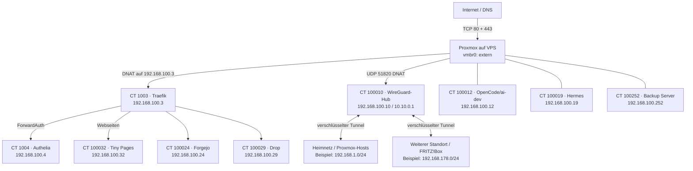

# Aufbau: Ein VPS verbindet Dienste und Standorte

Diese Seite zeigt unsere Anlage als nachvollziehbares Beispiel. Interne IPs und Container-IDs sind bewusst erhalten; öffentliche WAN-IP, Domains und persönliche Angaben sind nicht Teil der Darstellung. Du kannst auf deinem System andere IDs und Netze wählen.

Die Linien zu Forgejo und Drop zeigen deren Einordnung als über Traefik veröffentlichbare Webdienste; konkrete Router und Zugriffspolitiken müssen für die eigene Installation geprüft werden. Die Heimnetz- und FRITZ!Box-Strecken veranschaulichen die dokumentierte Hub-Topologie; eine aktuelle Ende-zu-Ende-Erreichbarkeit der Gegenstellen wurde bei dieser Bestandsaufnahme nicht behauptet.

## Die Bausteine

| Bestandteil | Beispiel | Aufgabe |
| --- | --- | --- |
| Proxmox VE | VPS, `vmbr1`: `192.168.100.1/24` | Host für LXC-Container und internes Gateway |
| Traefik | CT `1003`, `192.168.100.3` | Nimmt HTTP/HTTPS an und leitet nach Hostname weiter |
| Authelia | CT `1004`, `192.168.100.4` | Anmeldung, Richtlinien und zweiter Faktor |
| WireGuard | CT `100010`, `192.168.100.10`, Tunnel `10.10.0.1/16` | Verschlüsselte Standortverbindungen |
| OpenCode / ai-dev | CT `100012`, `192.168.100.12` | Entwicklungsumgebung |
| Hermes | CT `100019`, `192.168.100.19` | Agentendienst |
| Forgejo | CT `100024`, `192.168.100.24` | Git-Hosting |
| Drop | CT `100029`, `192.168.100.29` | Datei-/Übergabedienst |
| Tiny Pages | CT `100032`, `192.168.100.32` | Kleiner Webserver für statische Seiten |
| Proxmox Backup Server | CT `100252`, `192.168.100.252` | Backup-Ziel und Wiederherstellung |

**Stand der Messung:** Am 10. November 2026 wurden Containerstatus und die genannten LXC-Adressen lesend auf dem VPS abgefragt. `vmbr1`, die WireGuard-Interfaceadresse und die Route des Hosts zu `10.10.0.5` über `192.168.100.10` wurden ebenfalls ausgelesen. Diese Messungen zeigen keine aktuelle Anmeldung oder Ende-zu-Ende-Verbindung jedes Dienstes.

Weiter: [Netzwerk und DNAT](02-netzwerk-und-dnat.md) · [Anmeldung, Tiny Pages und Dienste](03-dienste-und-authelia.md) · [KI-Kopiervorlage](../README.md#kopiervorlage-für-deine-ki)
