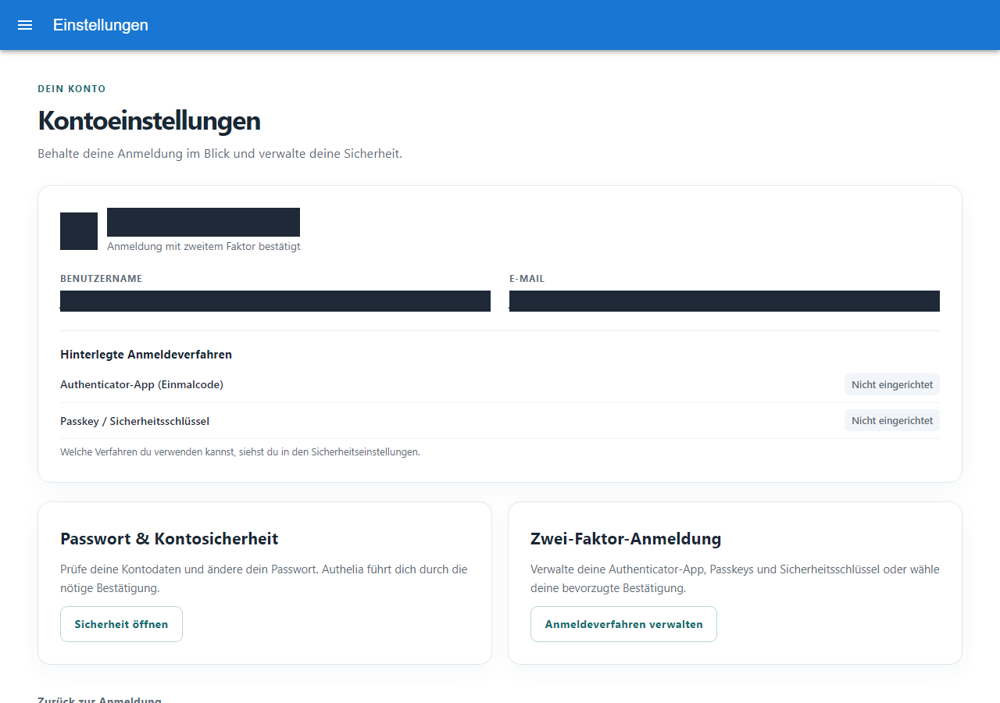
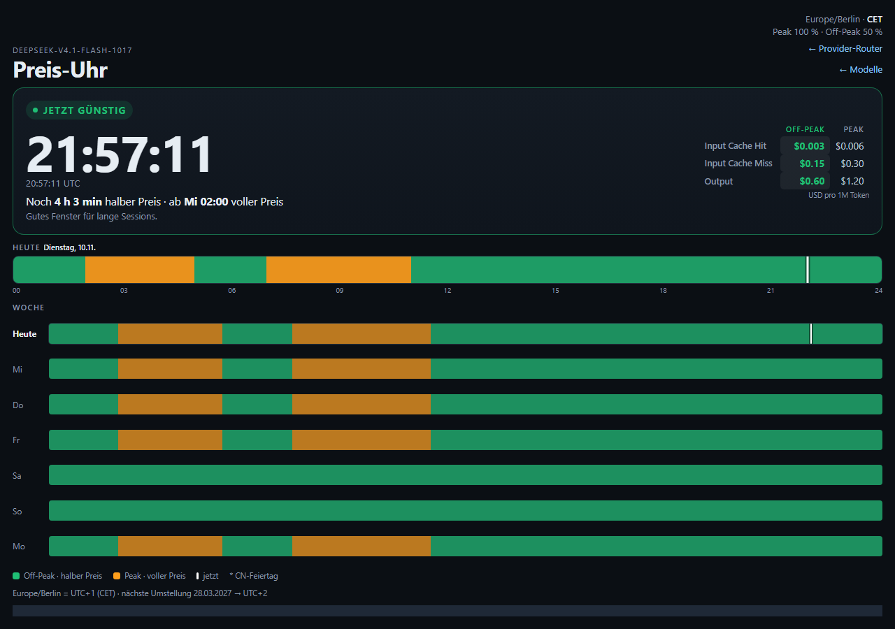

# Traefik, Authelia und die weiteren Dienste

## Der Weg einer Anfrage

1. DNS verweist entweder direkt auf die öffentliche Adresse des VPS oder – bei aktiviertem CDN-/DNS-Proxy – zunächst auf den vorgeschalteten Proxy. Dieser verbindet sich anschließend mit dem VPS als Origin; TLS-Einstellungen und vertrauenswürdige Client-IP-Header müssen zu diesem Weg passen.
2. Eingehendes TCP 80/443 erreicht durch die Portweiterleitung Traefik auf `192.168.100.3`.
3. Traefik wählt anhand des Hostnamens einen Router und leitet die Anfrage an den passenden internen Dienst.
4. Für geschützte Routen fragt Traefik Authelia nach der Berechtigung. Welche Routen welchen Schutz verlangen, bestimmen die tatsächlichen Router-, Middleware- und Authelia-Regeln.
5. Eine zugelassene Anfrage erreicht den Dienst. Der Backend-Port muss so geschützt sein, dass ein öffentlicher Direktzugriff die Anmeldung nicht umgeht.

Bei einem neuen Aufbau ist es hilfreich, zuerst nur eine einfache HTTPS-Testseite über Traefik zu prüfen. Danach kommen Authelia, der erste Benutzer und 2FA hinzu. So lässt sich ein Zertifikats- oder Routingfehler von einem Anmeldefehler unterscheiden.

## Authelia: Was läuft und was wurde geprüft?

Auf dem Beispiel-VPS lief bei der Abfrage am **10. November 2026** Authelia im CT `1004` als angepasster Build auf Basis **4.39.16**. Der separate Onboarding-Dienst war aktiv. Traefik im CT `1003` meldete Version **3.6.4**. Die fünf geprüften Quelldateien des laufenden Onboarding-Dienstes stimmten mit dem dokumentierten ursprünglichen Jarvis-Quellstand überein.

Es gab bereits am **1. Oktober 2026** dokumentierte echte Tests mit einem separaten Konto: Passwort und TOTP, Aufruf der Verwaltung sowie ausgewählte Gruppenänderungen. Am **10. November 2026** meldete der vorhandene Headless-Loginhelfer für dieses Konto erneut Erfolg bei Passwort und TOTP; die Kontoeinstellungen waren über HTTP 200 erreichbar. Der anschließende Zugriff auf die Administrationsseite lieferte bei diesem Test jedoch **HTTP 403**. Das ist ein konkreter offener Befund, keine Aussage, dass die ganze Anlage nicht funktioniert. Der 403 wurde nicht durch einen anderen Zugang umgangen. Die Kontoseite zeigte in derselben Sitzung Authentifizierungsstufe 2, meldete aber zugleich keine registrierte TOTP-/WebAuthn-/Duo-Methode. Diese abweichenden Anzeigen sind ein weiterer konkreter Prüfpunkt; aus dem Screenshot allein ist die Ursache nicht ersichtlich.

*Echte headless aufgenommene Kontoseite vom 10. November 2026. Identifizierende Kontofelder wurden vor der Aufnahme geschwärzt. Sie ist kein Nachweis für einen erfolgreichen Aufruf der separaten Benutzerverwaltung.*

Der öffentliche Code unter [Authelia Onboarding](https://github.com/WaldemarFech/authelia-onboarding) ist ein aus der Anlage abgeleiteter, verallgemeinerter Entwicklungsstand. Alle fünf geprüften Dienstdateien unterscheiden sich im öffentlichen Repository vom laufenden Originalstand; die Live-Tests sind deshalb keine automatische Funktionsbestätigung für das veröffentlichte Paket. Ein Port auf **4.39.28** wurde dort im isolierten Labor vorbereitet und getestet; er wurde bei dieser Arbeit **nicht** auf den laufenden VPS ausgerollt. Neuere Upstream-Versionen enthalten Sicherheitskorrekturen; vor einer Neuinstallation oder einem Upgrade die [Authelia-Releases](https://github.com/authelia/authelia/releases) und die Dokumentation der gewählten Version prüfen.

### Erster zweiter Faktor ohne Mailserver

Authelia kann Benachrichtigungen für ein isoliertes Labor in eine lokale Datei schreiben. Der [Filesystem-Notifier](https://www.authelia.com/configuration/notifications/file/) ist für Tests gedacht; die Datei kann Einmalcodes oder Links enthalten. Sie nur über eine geschützte eigene Konsole ansehen, restriktive Rechte setzen und Inhalt, QR-Codes, Schlüssel und Passwörter nicht in den KI-Chat, Logs, Screenshots oder Git kopieren. Für dauerhaften Betrieb ist ein geeigneter Zustell- und Wiederherstellungsweg zu planen.

## Tiny Pages

CT `100032` stellt kleine statische Seiten bereit. Für die dokumentierte Anlage wurden `nginx-light`, ein unprivilegierter Container und Weiterleitung durch Traefik beschrieben. Eine statische Seite braucht keine Datenbank und keine direkte öffentliche Portfreigabe, wenn Traefik sie intern erreicht. Bei einer eigenen Installation den tatsächlich laufenden Dienst und dessen Schreib- und Zugriffsrechte prüfen.

*Reale Aufnahme einer öffentlich erreichbaren Testseite vom 10. November 2026; eine Quellen-Domain wurde vor der Aufnahme geschwärzt. Angezeigte Preise und Zeiten sind ein Momentbild, keine Installationsvorgabe.*

## Forgejo, Drop, OpenCode und Hermes

- **Forgejo:** Git-Repositories und Zusammenarbeit; im Beispiel CT `100024` auf `192.168.100.24`.
- **Drop:** Dateien bzw. Übergaben; im Beispiel CT `100029` auf `192.168.100.29`. Rechte, Ablauffristen und Veröffentlichungsumfang gehören zur eigenen Konfiguration.
- **OpenCode / ai-dev:** Entwicklungsumgebung; im Beispiel CT `100012` auf `192.168.100.12`.
- **Hermes:** Agentendienst; im Beispiel CT `100019` auf `192.168.100.19`.

Die laufenden Container und Adressen wurden lesend abgefragt; eine vollständige Funktionsprüfung jedes Dienstes ist damit nicht verbunden. Insbesondere Administratoroberflächen nicht allein wegen eines funktionierenden Reverse Proxys öffentlich öffnen.

## Backup und Wiederherstellung

Der VPS-Backupserver läuft im Beispiel in CT `100252` auf `192.168.100.252`; die Abfrage meldete Paket `4.2.9-1` und laufende Version `4.2.6`. Ein Backup ist erst dann als wiederherstellbar belegt, wenn ein Restore in einer geeigneten Testumgebung gelingt. Konfiguration, Benutzerdaten, Datenbanken und die für ihre Entschlüsselung nötigen Schlüssel müssen zueinander passen. Alte Benutzer- oder MFA-Datenbanken nicht blind über aktuelle Daten zurückspielen.
