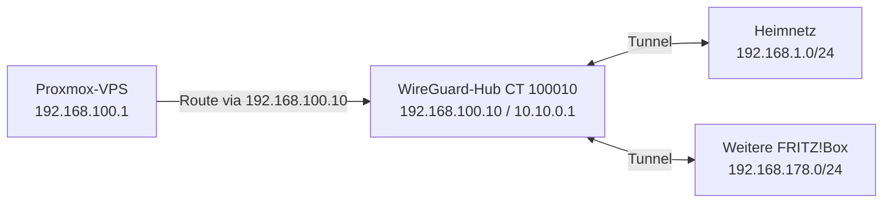

# WireGuard: VPS, Heimnetz und weiterer Standort

Der VPS kann als zentraler WireGuard-Hub dienen. Andere Standorte oder Geräte verbinden sich verschlüsselt mit diesem Hub; die Ziele bleiben private Netze. Im Beispiel läuft der Hub im LXC `100010` mit der VPS-internen Adresse `192.168.100.10` und dem Tunnelinterface `10.10.0.1/16`. Eine aktive DNAT-Regel leitet UDP `51820` an diesen Container weiter.



## Das Beispiel richtig lesen

Die Grafik zeigt das Prinzip: Der Hub besitzt Routen in beide Beispielnetze. Sie sagt nicht, dass **jeder** Container oder der Proxmox-Host selbst bereits eine Route und Firewallfreigabe zu jedem Ziel hat. Dafür sind Hinweg, Rückweg, Peer-Konfiguration und Firewall gesondert zu prüfen.

Am **10. November 2026** ergab eine lesende Routenabfrage:

| Wo wurde gefragt? | Ziel | Gewählte Route |
| --- | --- | --- |
| Proxmox-VPS | `192.168.1.1` | über `192.168.100.10` auf `vmbr1` |
| Proxmox-VPS | `192.168.178.1` | Standardroute auf `vmbr0`, nicht über den Hub |
| WireGuard-Container | `192.168.1.1` | `wg0` |
| WireGuard-Container | `192.168.178.1` | `wg0` |

Eine ausgewählte Route beweist **weder** einen aktuellen Tunnel-Handshake noch eine funktionierende Antwort vom Ziel. Ein älterer Standorttest dokumentiert die Verbindung zum FRITZ!Box-Netz; bei der hier gezeigten Abfrage wurde sie nicht erneut Ende zu Ende geprüft. Gerade bei `192.168.178.0/24` zeigt der Unterschied zwischen Host und Hub, warum man die Route am tatsächlichen Ausgangspunkt überprüfen muss.

## So prüfst du deine eigene Verbindung

```sh
# Auf dem Proxmox-Host: Welchen Weg würde der Host wählen?
ip route get 192.168.1.1
ip route get 192.168.178.1

# Im WireGuard-Container: ID und Ziele an dein Netz anpassen
pct exec 100010 -- ip -4 -br address
pct exec 100010 -- ip route get 192.168.1.1
pct exec 100010 -- ip route get 192.168.178.1
```

Prüfe anschließend Tunnelstatus, Firewall und Rückroute auf beiden Seiten sowie einen ausdrücklich freigegebenen Zielhost. Überlappende Subnetze oder `AllowedIPs`, die demselben Ziel mehrfach zugeordnet sind, können eine Verbindung in die falsche Richtung lenken. Netz- und Firewalländerungen nur mit Konsole und Rückfallweg durchführen.

**Keine Geheimnisse veröffentlichen:** PrivateKeys, Preshared Keys, vollständige WireGuard-Konfigurationen, öffentliche WAN-Adressen und persönliche Host-/Domainnamen aus Screenshots und Protokollen entfernen. Für Screenshots öffentliche IP und identifizierende Daten vor der Veröffentlichung schwärzen.
